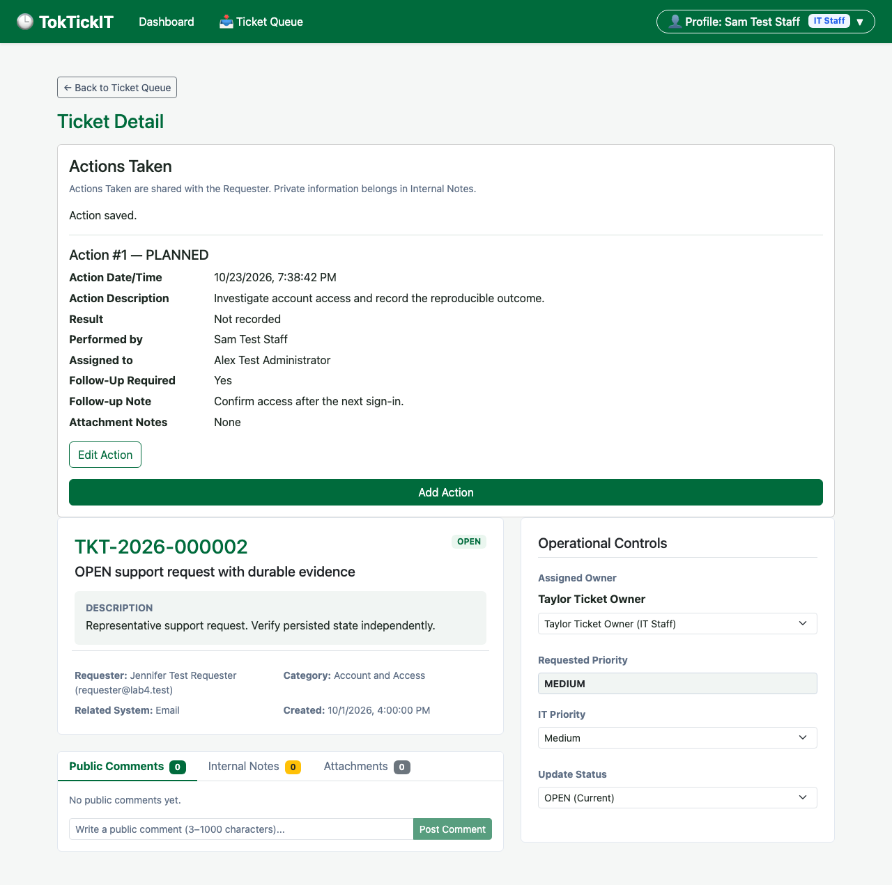

# Current Actions Taken screenshot evidence — raw Ticket ID removed

These are the latest approved Issue 27 captures, committed with the matching UI in `74c8bc7`. The Staff Ticket Detail header does not display the raw database Ticket ID. Ordinary viewing does not display the permanent resolution/closure warning; contextual guidance appears only for a selected blocked transition.

Use this folder for current candidate submission evidence. Screenshots under `regression/issue-27/history/` are superseded historical evidence and must not be used as current submission captures.

## Latest desktop baseline

## All 11 current captures

| Scenario | Desktop | Tablet | Mobile |
| --- | --- | --- | --- |
| Planned Action / Staff Ticket Detail | [Desktop](baseline-desktop.png) | [Tablet](baseline-tablet.png) | [Mobile](baseline-mobile.png) |
| Required Follow-Up Note validation | [Desktop](validation-desktop.png) | [Tablet](validation-tablet.png) | [Mobile](validation-mobile.png) |
| Requester read-only completed/cancelled Actions | [Desktop](requester-read-only-desktop.png) | [Tablet](requester-read-only-tablet.png) | [Mobile](requester-read-only-mobile.png) |
| Contextual blocked resolution | [Desktop](blocked-resolution-desktop.png) | — | — |
| Stale conflict with retained draft | [Desktop](stale-conflict-desktop.png) | — | — |

The [current manifest](../../manifest.json) records the asserted scenarios, run identity and PNG hashes. This index clarifies the evidence location; it does not regenerate screenshots or claim a new test run. Final-main/release and submission assembly remain Issue 28.
